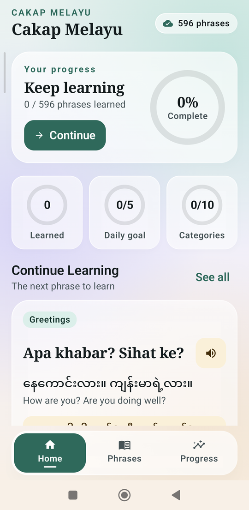
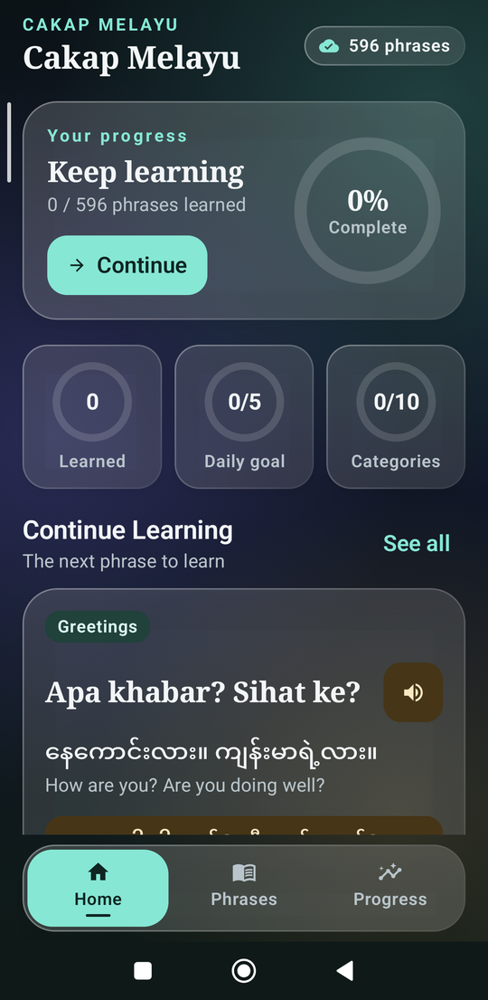
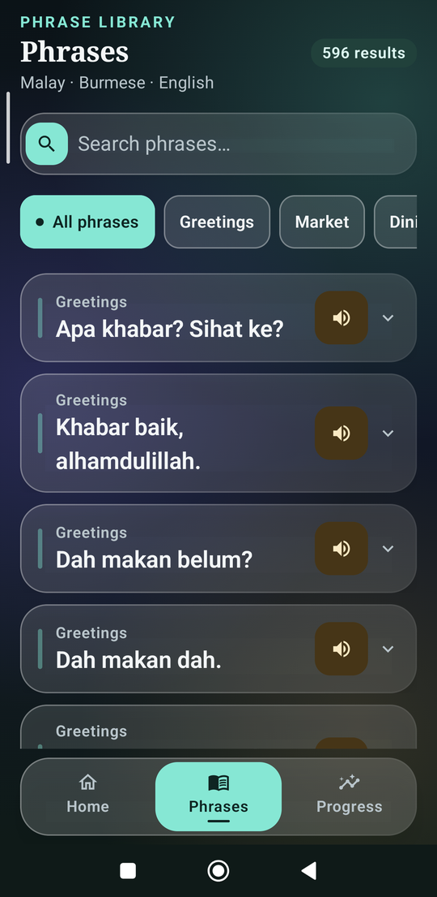

<p align="left">
  
</p>

# MalaySpeak (Cakap Melayu)

An offline Android phrasebook in Jetpack Compose for learning conversational Malaysian Malay with Burmese and English translations, pronunciation guides, and local progress tracking.

## Download

- Latest release APK: [GitHub Releases](https://github.com/ong-ki/MalaySpeak/releases/latest)
- Signed release APK in repo: [`release/MalaySpeak-v1.0.0.apk`](release/MalaySpeak-v1.0.0.apk)

## Features

- **100% Offline Phrase Library**: Bundles 540 conversational phrases across 10 categories (*Greetings*, *Market*, *Dining*, *Transport*, *Work*, *Housing*, *Numbers & time*, *Health & emergency*, *Daily life*, *Slang & particles*) in Room SQLite (`assets/phrases.json` with `PhraseSeedData` fallback). No internet permission is declared.
- **Tri-Script Search & Category Filtering**: Instant SQLite `LIKE` search across Malay phrases, Burmese meanings, English meanings, and Burmese-script pronunciation guides, paired with a horizontal category filter rail.
- **Expandable Phrase Cards**: Tap any card to reveal the Malay phonetic guide, Burmese and English meanings, colloquial Malaysian usage notes, and learned toggle.
- **Offline Malay Speech Playback**: Uses Android `TextToSpeech` (`ms-MY`) with offline-voice checks and a fallback dialog directing users to system TTS settings when Malay voice data is unavailable.
- **Progress Dashboard & Daily Goal**: Home dashboard and Progress insights featuring circular and concentric progress rings, daily goal tracking (5 phrases/day), per-category completion rings, and progress reset.
- **Theme Persistence**: Supports System, Light, and Dark appearance modes stored in Jetpack DataStore Preferences.

## Screenshots

| Screen | Light | Dark |
|---|---|---|
| **Home** |  |  |
| **Phrases** |  |  |
| **Progress** |  |  |

## Build Instructions

### Requirements

- JDK 17
- Android SDK (`compileSdk = 34`, `minSdk = 26`, `targetSdk = 34`)

### Commands

```bash
cd android
./gradlew assembleDebug
./gradlew assembleRelease
./gradlew testDebugUnitTest
```

Release builds enable R8 code shrinking/obfuscation (`isMinifyEnabled = true`) and resource shrinking (`isShrinkResources = true`).

## Tech Stack

- **Language & UI**: Kotlin `1.9.22`, Jetpack Compose (BOM `2024.04.00`), Material 3, Material Icons Extended, Navigation Compose `2.7.7`
- **Architecture & State**: AndroidX Lifecycle / ViewModel / Runtime Compose `2.7.0`, Core SplashScreen `1.0.1`
- **Persistence**: Room `2.6.1` (KSP `1.9.22-1.0.17`), DataStore Preferences `1.0.0`
- **Async & Speech**: Kotlinx Coroutines `1.8.0`, Android `TextToSpeech`
- **Unit Testing**: JUnit 4, MockK, Robolectric, AndroidX Test Core, Kotlinx Coroutines Test

## Project Structure

```text
.
├── android/
│   ├── app/src/main/
│   │   ├── assets/phrases.json          # Bundled offline phrase catalogue
│   │   ├── java/com/malayspeak/app/
│   │   │   ├── data/                    # Room DB, DAOs, seed data, DataStore, TTS player
│   │   │   └── ui/                      # Compose screens, components, navigation, theme
│   │   └── res/                         # Adaptive/splash icons, strings, themes
│   ├── app/src/test/                    # Robolectric + unit tests
│   └── gradle/libs.versions.toml        # Version catalog
├── docs/
│   ├── icon.png                         # App icon (512x512)
│   └── screenshots/                     # Light & dark device screenshots
├── release/MalaySpeak-v1.0.0.apk        # Signed release APK
├── src/                                 # Early web prototype (Vite/React)
├── LICENSE
├── THIRD_PARTY_NOTICES.md
└── README.md
```

## License

Licensed under the [MIT License](LICENSE) — Copyright (c) 2026 ong-ki.

See [THIRD_PARTY_NOTICES.md](THIRD_PARTY_NOTICES.md) for third-party library licenses and dataset/font attributions.
