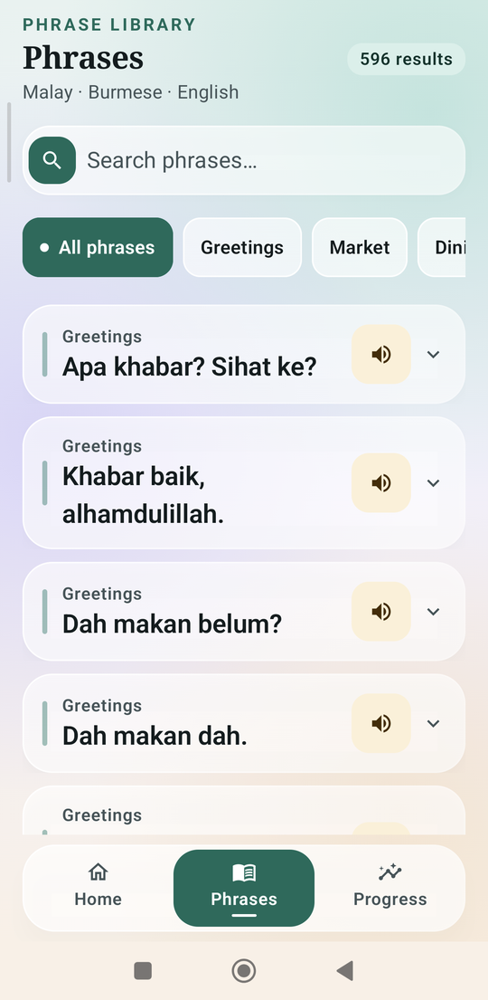
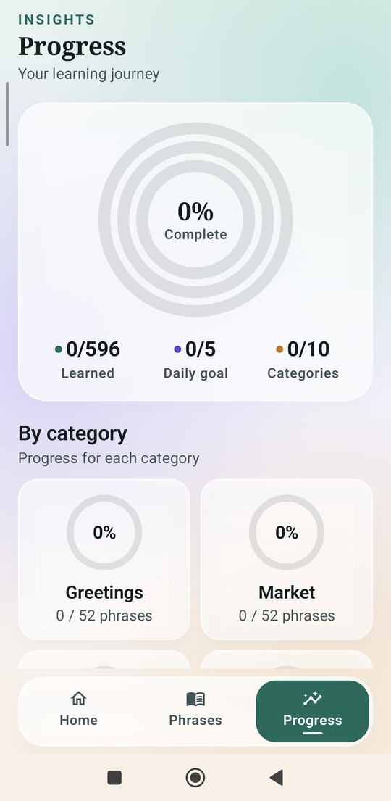
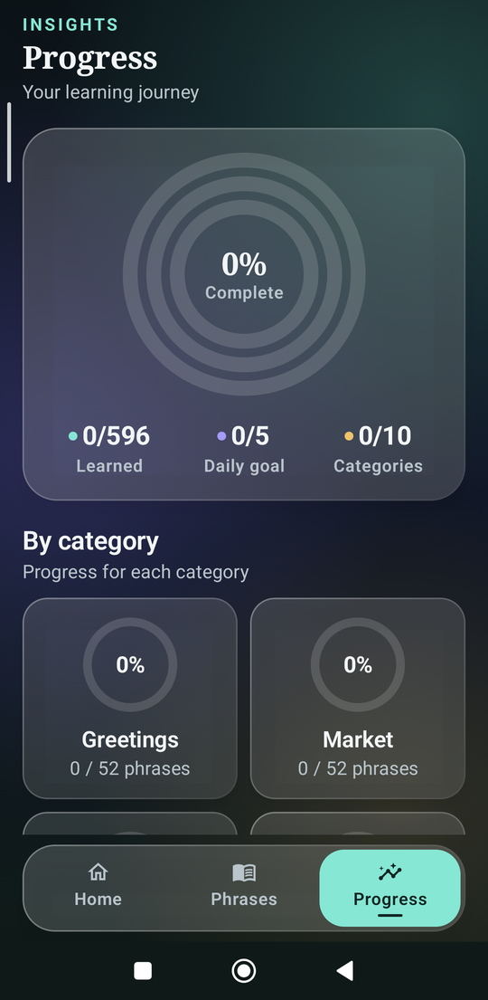

<div align="center">
  
  <h1>MalaySpeak (Cakap Melayu)</h1>
  <p>An offline Android phrasebook in Jetpack Compose for learning conversational Malaysian Malay with Burmese and English translations, pronunciation guides, and local progress tracking.</p>
  <p>
    <a href="https://github.com/ong-ki/MalaySpeak/releases/latest"></a>
    
    
    
    <a href="LICENSE"></a>
    
  </p>

[](https://github.com/ong-ki/MalaySpeak/releases/latest)

<sub>Android 8.0+ - ~1.4 MB - works fully offline</sub>

</div>

---

## Screenshots

<div align="center">

| Home | Phrases | Progress |
| :---: | :---: | :---: |
|  |  |  |

</div>

<details>
<summary>Dark mode</summary>

<div align="center">

| Home | Phrases | Progress |
| :---: | :---: | :---: |
|  |  |  |

</div>

</details>

## Features

- **660 offline phrases**: Bundled locally in Room SQLite (`assets/phrases.json` with `PhraseSeedData` fallback) with no internet permission declared.
- **Tri-script search and filtering**: Instant SQLite `LIKE` search across Malay text, Burmese and English meanings, and Burmese-script pronunciation guides, paired with a category filter rail.
- **Expandable phrase cards**: Tap any card to reveal the Malay phonetic guide, Burmese and English translations, Malaysian usage notes, and learned toggle.
- **Offline Malay speech playback**: Uses Android `TextToSpeech` (`ms-MY`) with offline-voice checks and a dialog directing users to system TTS settings when voice data is unavailable.
- **Progress dashboard and daily goal**: Home and Progress screens with circular and concentric progress rings, a 5-phrase daily goal, per-category completion tracking, and progress reset.
- **Theme persistence**: Supports System, Light, and Dark appearance modes stored locally in Jetpack DataStore Preferences.

## Phrase Categories

Greetings · Market · Dining · Transport · Work · Housing · Numbers & time · Health & emergency · Daily life · Slang & particles

---

<details>
<summary>Build from source</summary>

**Requirements**

- JDK 17
- Android SDK (`compileSdk = 34`, `minSdk = 26`, `targetSdk = 34`)

**Commands**

```bash
cd android
./gradlew assembleDebug
./gradlew assembleRelease
./gradlew testDebugUnitTest
```

Release builds enable R8 code shrinking/obfuscation (`isMinifyEnabled = true`) and resource shrinking (`isShrinkResources = true`).

</details>

<details>
<summary>Tech stack</summary>

- **Language & UI**: Kotlin `1.9.22`, Jetpack Compose (BOM `2024.04.00`), Material 3, Material Icons Extended, Navigation Compose `2.7.7`
- **Architecture & State**: AndroidX Lifecycle / ViewModel / Runtime Compose `2.7.0`, Core SplashScreen `1.0.1`
- **Persistence**: Room `2.6.1` (KSP `1.9.22-1.0.17`), DataStore Preferences `1.0.0`
- **Async & Speech**: Kotlinx Coroutines `1.8.0`, Android `TextToSpeech`
- **Unit Testing**: JUnit 4, MockK, Robolectric, AndroidX Test Core, Kotlinx Coroutines Test

</details>

<details>
<summary>Project structure</summary>

```text
.
├── android/
│   ├── app/src/main/
│   │   ├── assets/phrases.json          # Bundled offline phrase catalogue (660 phrases)
│   │   ├── java/com/malayspeak/app/
│   │   │   ├── data/                    # Room DB, DAOs, seed data, DataStore, TTS player
│   │   │   └── ui/                      # Compose screens, components, navigation, theme
│   │   └── res/                         # Adaptive/splash icons, strings, themes
│   ├── app/src/test/                    # Robolectric + unit tests
│   └── gradle/libs.versions.toml        # Version catalog
├── docs/
│   ├── icon.png                         # App icon (512x512)
│   └── screenshots/                     # Light & dark device screenshots
├── LICENSE
├── THIRD_PARTY_NOTICES.md
└── README.md
```

</details>

---

Licensed under the [MIT License](LICENSE) — Copyright (c) 2026 ong-ki. See [THIRD_PARTY_NOTICES.md](THIRD_PARTY_NOTICES.md) for third-party library licenses and attributions.
